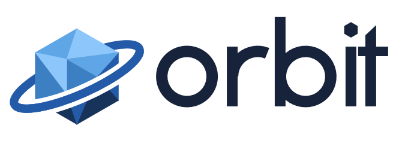
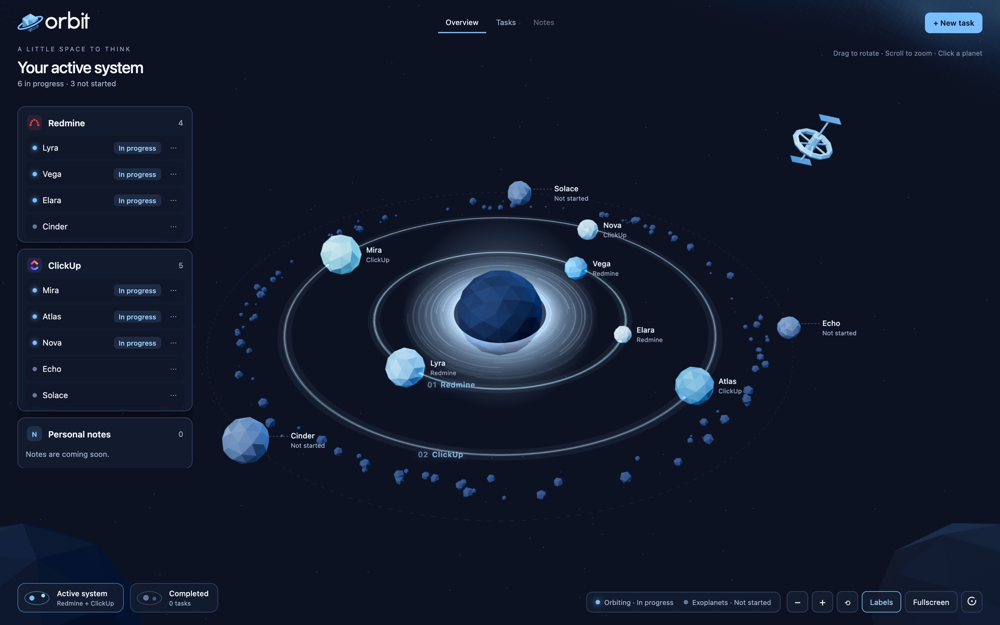
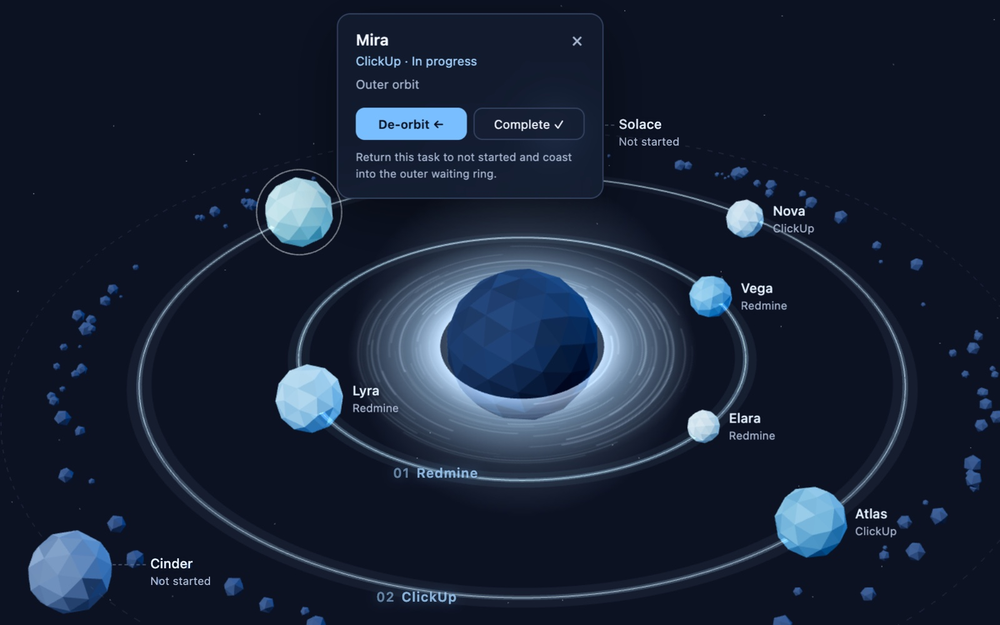
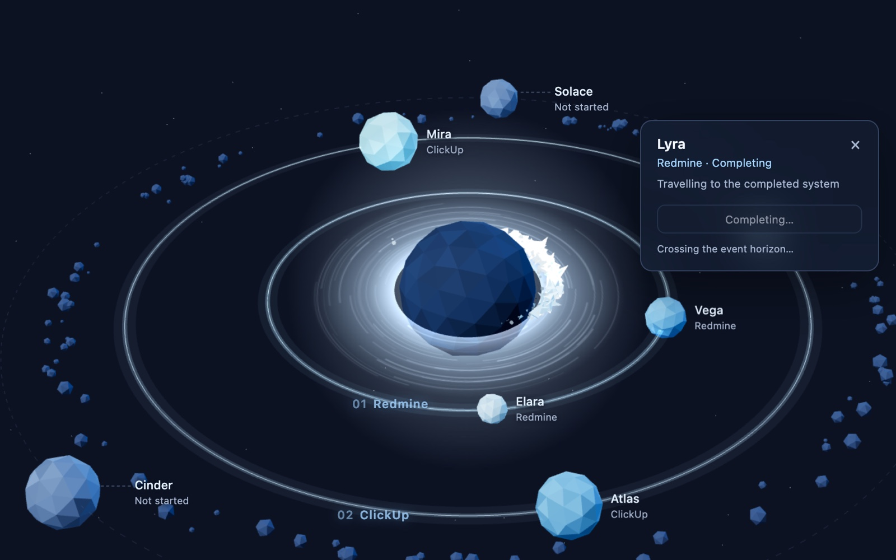
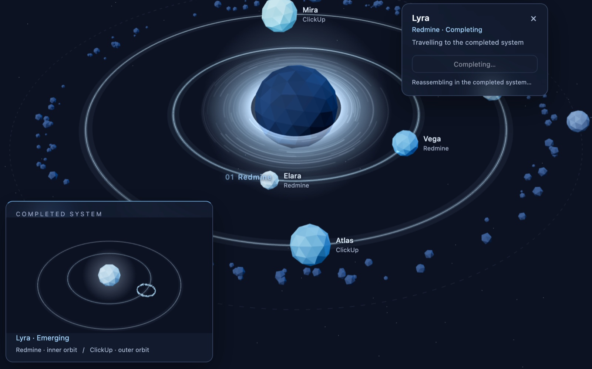
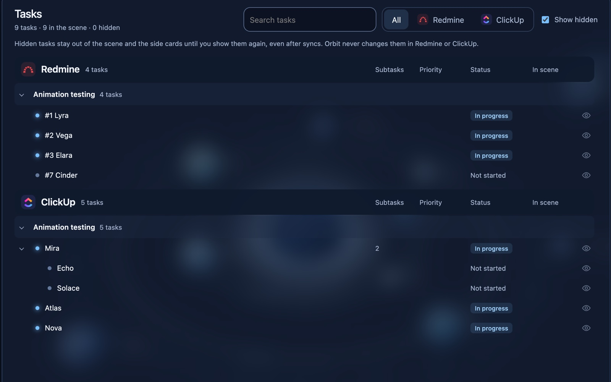
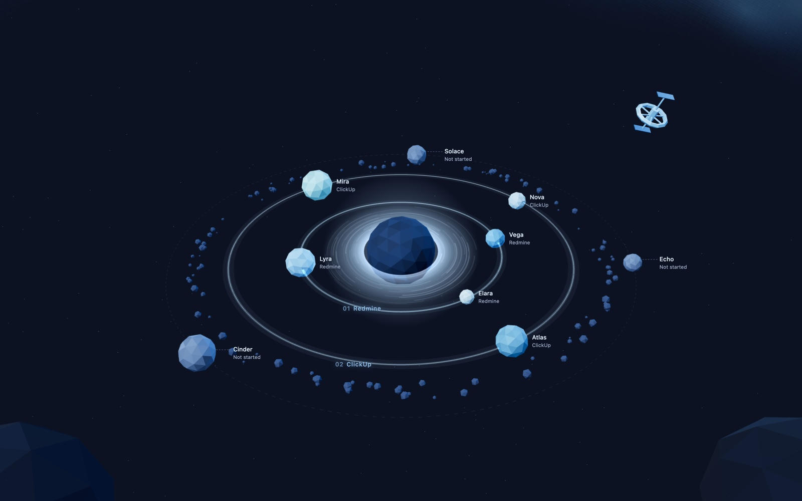
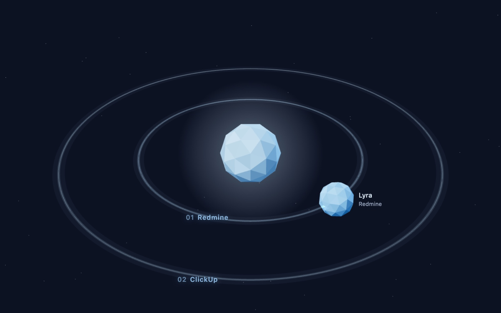
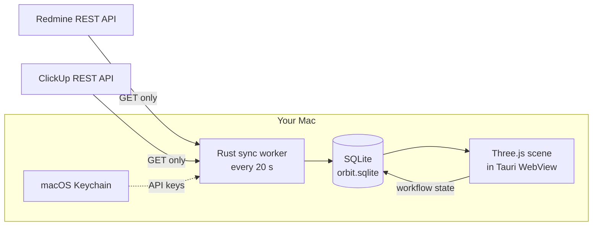
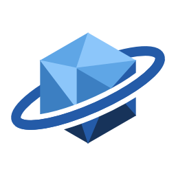

<div align="center">

<picture>
  <source media="(prefers-color-scheme: dark)" srcset="design/logo/masters/orbit-lockup-horizontal-dark.svg">
  
</picture>

### Your tasks, as a solar system you can watch from a second screen.

Orbit is a local Mac app that turns your Redmine and ClickUp assignments into low‑poly planets.<br>
Work in progress circles the core. Finished work falls into it.

<p>
  
  
  
  
  
</p>

<p>
  <a href="#quick-start"><b>Quick start</b></a> ·
  <a href="#how-it-works"><b>How it works</b></a> ·
  <a href="#privacy-by-design"><b>Privacy</b></a> ·
  <a href="desktop/README.md"><b>Desktop guide</b></a> ·
  <a href="#roadmap"><b>Roadmap</b></a>
</p>



</div>

<br>

## Why Orbit

Task lists are built to be scanned, then closed. Orbit is built to stay open. It lives on your second monitor, keeps itself in sync, and shows the shape of your week at a glance: what you are working on, what is still waiting, and how much has quietly moved to done.

- **One sky for every source.** Redmine tickets ride the inner ring, ClickUp tasks the outer one. Unstarted work waits as exoplanets on the outer waiting ring.
- **Your workflow, not theirs.** Orbit keeps its own *Not started / In progress / Done* state for each task. It never writes back to Redmine or ClickUp.
- **Local and quiet.** No account, no server, no telemetry. Tasks live in SQLite on your Mac, API keys in macOS Keychain.

## Features

<table>
  <tr>
    <td width="50%" valign="top">
      
      <h3>Click a planet, move a task</h3>
      <p>Select any planet to see its source, status and a link back to the original ticket. <b>Enter orbit</b> starts a task with an eased transfer onto its source ring. <b>De-orbit</b> sends it back to the waiting ring.</p>
    </td>
    <td width="50%" valign="top">
      
      <h3>Completion you can feel</h3>
      <p>Finishing a task decays its orbit. The planet spirals inward, crumbles into a debris cloud that circles once more, and falls into the core with a flare.</p>
    </td>
  </tr>
  <tr>
    <td width="50%" valign="top">
      
      <h3>A second system for finished work</h3>
      <p>Done tasks reassemble in their own system, shown in a live glimpse as they arrive. Travel there with one of five camera transitions: glide, warp, core, map or dip.</p>
    </td>
    <td width="50%" valign="top">
      
      <h3>Tasks tab for the long lists</h3>
      <p>Source, then list, then task, then subtasks, with search and filters. Hide a task, a branch or a whole list from the sky. Hidden stays hidden across every sync.</p>
    </td>
  </tr>
  <tr>
    <td width="50%" valign="top">
      
      <h3>Zen mode</h3>
      <p>Press <kbd>Z</kbd> and every panel disappears, leaving only the sky. Made for a fullscreen second display.</p>
    </td>
    <td width="50%" valign="top">
      
      <h3>Built to stay open all day</h3>
      <p>Rendering stops when the window is hidden or minimised and resumes from the latest state, with no replayed animations. Frame limit and resolution are yours to set; Orbit never degrades quality behind your back.</p>
    </td>
  </tr>
</table>

## Quick start

You need **Node.js**, **Rust** and **Xcode** (or its Command Line Tools) on a Mac.

```sh
git clone https://github.com/AmmarJ23/Orbit.git
cd Orbit/desktop
npm ci
npm run dev
```

That opens the native app with hot reload. To see the scene without connecting anything, run the demo, which ships sample planets and animation controls:

```sh
npm run dev:demo
```

Build a standalone app bundle:

```sh
npm run build
open src-tauri/target/release/bundle/macos/Orbit.app
```

Then open **Settings** (the space station, or <kbd>⌘</kbd> <kbd>,</kbd>), add your Redmine server and API key or your ClickUp token, and your assigned tasks arrive as planets.

> [!NOTE]
> Builds are local development bundles. They are not notarised for distribution, and Windows has not been tested yet. The [desktop guide](desktop/README.md) covers modes, environment flags and native verification.

## How it works



| Layer | What it does |
| --- | --- |
| **Sync** | A native worker polls each connected source every 20 seconds, fetches every page, then reconciles. A task missing from a complete snapshot becomes Done; one that returns becomes Not started. Failed or partial fetches never change state. |
| **Storage** | One versioned, transactional document in `~/Library/Application Support/my.ammar.orbit/orbit.sqlite`: tasks, workflow states, appearance seeds, preferences and last sync. Cached tasks work offline. |
| **Credentials** | Keys go straight to macOS Keychain and never return to the web layer. An optional VPN can be connected automatically before each Redmine sync. |
| **Scene** | Plain JavaScript and Three.js, rendered in WKWebView. One render loop, gated on visibility rather than focus, so the sky keeps moving on a second screen. |
| **Window** | Closing hides Orbit and keeps syncing; <kbd>⌘</kbd> <kbd>Q</kbd> quits. Position, size and fullscreen are restored on launch. |

## Privacy by design

- **Read‑only integrations.** Orbit only sends `GET` requests to Redmine and ClickUp. Your source statuses are never changed.
- **No backend.** Nothing leaves your Mac except those requests to the servers you configure.
- **Secrets stay in Keychain.** The database stores a reference to each credential, never the key itself.
- **The demo is sealed off.** `Orbit Demo.app` has its own bundle identifier and cannot reach live storage, credentials or sync.

## Project layout

| Path | Contents |
| --- | --- |
| [`desktop/`](desktop/) | The Mac app: Tauri 2 shell in Rust, Three.js scene, sync, storage. |
| [`redmine/`](redmine/) | Standalone, GET‑only Redmine client and CLI. |
| [`clickup/`](clickup/) | Standalone, read‑only ClickUp client and CLI. |
| [`prototype/planetary-animation/`](prototype/planetary-animation/README.md) | The original browser animation study the app grew from. |
| [`design/`](design/) | Logo system, palette, concept art and motion research. |
| [`DISCUSSION.md`](DISCUSSION.md) | Product decisions and the locked platform direction. |

## Roadmap

- [x] Native Mac shell with restored window state and hide‑to‑background
- [x] Persistent local workflow state in SQLite
- [x] Redmine sync, with optional VPN before each sync
- [x] ClickUp sync, subtasks included
- [x] Hide and reveal tasks, branches and lists
- [x] Completed system with five travel transitions
- [x] Zen mode
- [ ] Personal notes as their own planets
- [ ] Gentle sound alerts for new assignments
- [ ] Full navigation of the completed system
- [ ] Signed, notarised releases
- [ ] Windows build

<br>

<div align="center">
  <picture>
    <source media="(prefers-color-scheme: dark)" srcset="design/logo/masters/orbit-symbol-dark.svg">
    
  </picture>
  <br>
  <sub>Everything in Orbit.</sub>
</div>
